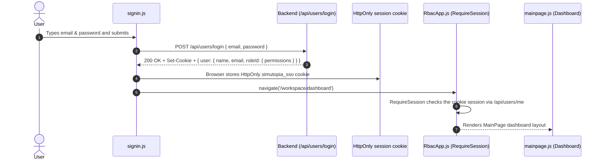
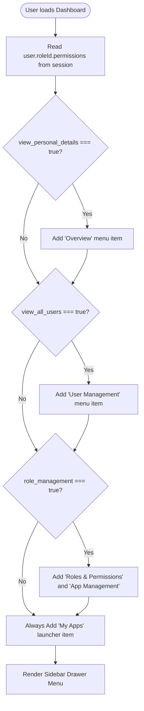

# 🎨 SimutopiaHomePage — Complete Frontend Architecture & Code Guide

> **Welcome to the SimutopiaHomePage documentation!**  
> This guide is crafted so that **anyone on the team can understand the entire frontend project structure, every file's purpose, how data travels, and how it connects to the backend**, without having to read through all source files.

---

## 🧭 Table of Contents
1. [What is SimutopiaHomePage? (The Big Picture)](#1-what-is-simutopia-homepage-the-big-picture)
2. [High-Level Architecture & Dual-Mode Concept](#2-high-level-architecture--dual-mode-concept)
3. [Folder & File Directory Tree](#3-folder--file-directory-tree)
4. [File-by-File Deep Dive (Content, Purpose & Connections)](#4-file-by-file-deep-dive)
   - [Root & App Setup Files](#root--app-setup-files)
   - [Public Marketing Website Components (`src/components/`)](#public-marketing-website-components-srccomponents)
   - [Enterprise Workspace & RBAC Engine (`src/rbac/`)](#enterprise-workspace--rbac-engine-srcrbac)
   - [Dashboard Pages (`src/rbac/components/dashboard/pages/`)](#dashboard-pages-srcrbaccomponentsdashboardpages)
   - [Shared Providers & Contexts (`src/rbac/components/`)](#shared-providers--contexts-srcrbaccomponents)
5. [Core Frontend Workflows (Step-by-Step)](#5-core-frontend-workflows-step-by-step)
   - [Workflow 1: Public Homepage Navigation](#workflow-1-public-homepage-navigation)
   - [Workflow 2: Workspace Sign-In & Token Persistence](#workflow-2-workspace-sign-in--token-persistence)
   - [Workflow 3: Dynamic Permission-Based Menu Rendering](#workflow-3-dynamic-permission-based-menu-rendering)
   - [Workflow 4: Managing Roles & App Access](#workflow-4-managing-roles--app-access)
   - [Workflow 5: Global Notifications via `useSnackbar()`](#workflow-5-global-notifications-via-usesnackbar)
6. [Frontend ↔ Backend Communication (API Contract)](#6-frontend--backend-communication-api-contract)
7. [Production Deployment Checklist](#7-production-deployment-checklist)

---

## 1. What is SimutopiaHomePage? (The Big Picture)

**SimutopiaHomePage** is a modern Single Page Application (SPA) built with **React 18** and **Material UI (MUI)**.

It combines **two key platforms** into a single cohesive project:

1. **The Public Marketing Website (`/`):** A high-performance company landing page showcasing Simutopia's engineering, simulation services, industries, and leadership team.
2. **The Simutopia Enterprise Workspace (`/workspace/*`):** A role-governed administrative portal where users and administrators sign in, manage users, configure RBAC roles, register connected apps, and launch enterprise tools.

---

## 2. High-Level Architecture & Dual-Mode Concept

```mermaid
flowchart TD
    User([User Browser]) --> Router{React Router (App.js)}

    subgraph PublicSite["1. Public Marketing Website (Path: '/')"]
        Header["Header.js (Navigation)"]
        Brand["BrandStatement.js (Vision)"]
        Why["WhySim.js (Why Choose Simutopia)"]
        Industries["Industries.js (Medical, Robotics, etc.)"]
        Services["Services.js (Simulation Capabilities)"]
        About["AboutUs.js (Leadership Team)"]
        Contact["ContactSection.js (Inquiry Form)"]
        Footer["Footer.js (Footer Links)"]
    end

    subgraph WorkspaceApp["2. Enterprise RBAC Workspace (Path: '/workspace/*')"]
        RbacApp["RbacApp.js (Theme & Session Guard)"]
        
        subgraph AuthPages["Auth & Portal"]
            PortalHome["homepage.js (Workspace Entry)"]
            SigninPage["signin.js (Login & SSO Return)"]
        end

        subgraph SessionControl["Session & Protected Shell"]
            SessionGuard["RequireSession Guard"]
            MainDashboard["mainpage.js (Dashboard Layout)"]
        end

        subgraph FeaturePages["Dashboard Feature Pages"]
            HomeTab["home.js (Overview)"]
            UsersTab["usermanagement.js & usertable.js"]
            RolesTab["rolemanagement.js"]
            AppsTab["appmanagement.js"]
            MyAppsTab["myapps.js"]
            RequestsTab["requestmanagement.js"]
        end

        subgraph SharedContexts["Global State Providers"]
            SnackbarCtx["snackbar.js (Toast Context)"]
            PopperCtx["poppercontext.js (Menu Context)"]
        end
    end

    Router -->|Path: '/'| PublicSite
    Router -->|Path: '/workspace/*'| WorkspaceApp
    RbacApp --> SessionGuard --> MainDashboard --> FeaturePages
    WorkspaceApp -.-> SharedContexts
```

---

## 3. Folder & File Directory Tree

Below is the clean file hierarchy of `SimutopiaHomePage` (excluding `node_modules` and compiled `build/` files):

```text
SimutopiaHomePage/
├── public/
│   ├── index.html                    # Root HTML document with font imports
│   ├── manifest.json                 # Web app manifest
│   ├── robots.txt                    # Search engine crawler policies
│   └── images/                       # Team pictures, industry icons & brand logos
│
├── src/
│   ├── index.js                      # React DOM mounting & root render
│   ├── App.js                        # Primary router switching between Website and Workspace
│   ├── global.css                    # Global typography and reset styles
│   │
│   ├── components/                   # Public Marketing Landing Page components
│   │   ├── Header.js                 # Top navigation bar with anchor links & logo
│   │   ├── BrandStatement.js         # Company mission statement
│   │   ├── WhySim.js                 # Core value propositions
│   │   ├── Industries.js             # Industries served (Robotics, Medical, etc.)
│   │   ├── Services.js               # Service offerings
│   │   ├── AboutUs.js                # Team bios and leadership profiles
│   │   ├── ContactSection.js         # Contact & inquiry form
│   │   ├── NavbarScrollButtons.js    # Smooth-scroll anchor helpers
│   │   └── Footer.js                 # Footer links and copyright
│   │
│   └── rbac/                         # Enterprise RBAC Workspace application
│       ├── App.css                   # Workspace custom styles
│       ├── constants.js              # Backend API base URL and endpoint routes
│       ├── RbacApp.js                # Workspace router, theme setup, & session guard
│       │
│       └── components/
│           ├── homepage.js           # Workspace landing / launchpad
│           ├── poppercontext.js      # Context for menus and popovers
│           ├── snackbar.js           # Global toast notifications context (useSnackbar)
│           │
│           ├── signin/
│           │   └── signin.js         # Login page with password verification & SSO redirect
│           │
│           └── dashboard/
│               ├── mainpage.js       # Main dashboard layout (AppBar, Drawer, Navigation)
│               └── pages/
│                   ├── home.js               # User overview page
│                   ├── usermanagement.js     # User list & action bar
│                   ├── usertable.js          # User table with status toggles & role dropdowns
│                   ├── rolemanagement.js     # Role builder with permission toggles
│                   ├── appmanagement.js      # App registration, client secrets, & URLs
│                   ├── myapps.js             # User app launcher (accessible apps)
│                   └── requestmanagement.js  # Account registration review queue
│
├── package.json                      # Project dependencies (React, MUI, React Router)
├── package-lock.json                 # Pinned dependencies
└── README.md                         # Project read-me
```

---

## 4. File-by-File Deep Dive

### Root & App Setup Files

#### `src/index.js`
- **What it does:** The JavaScript entry point. Mounts the React application tree into the HTML `<div id="root">` element.

#### `src/App.js`
- **What it does:** The master router for the entire project.
- **Key contents:**
  - Configures the public site theme (blue `#0d6efd`, Nunito font).
  - Routes:
    - `/`: Renders the full public marketing homepage components.
    - `/workspace/*`: Delegates all sub-routes to `<RbacApp />`.
    - `*`: Catches unmatched URLs and redirects back to `/`.

---

### Public Marketing Website Components (`src/components/`)

| File | UI Section | Description & Responsibilities |
|------|------------|--------------------------------|
| `Header.js` | Top Bar | Fixed header with brand logo, smooth navigation anchors (Services, Industries, About), and link to `/workspace/signin`. |
| `BrandStatement.js` | Hero Header | High-impact brand introduction and value statement. |
| `WhySim.js` | Value Highlights | Explains why clients choose Simutopia's simulation and modeling platform. |
| `Industries.js` | Industry Showcase | Cards detailing applications in Medical Devices, Robotics, Heavy Equipment, Entertainment, and Industrial Automation. |
| `Services.js` | Core Capabilities | Explains simulation development, hardware-in-the-loop (HIL) testing, and control systems. |
| `AboutUs.js` | Team & Leadership | Executive bios for Durga, Gabe, Krishna, Pavan, Ramana, and Rinky with profile pictures from `public/images/`. |
| `ContactSection.js` | Contact Form | Allows prospective clients and partners to submit inquiries. |
| `Footer.js` | Bottom Footer | Copyright, contact info, and legal links. |

---

### Enterprise Workspace & RBAC Engine (`src/rbac/`)

#### `src/rbac/constants.js`
- **What it does:** Central registry of backend endpoints.
- **Key contents:**
  ```javascript
  const API = {
    DATA_URL: process.env.REACT_APP_API_URL || "http://localhost:5000",
    DATA_ENDPOINTS: {
      signin: "/api/users/login",
      currentUser: "/api/users/me",
      getAllUsers: "/api/users/userslist",
      getAllRoles: "/api/roles/roleslist",
      getAssignableRoles: "/api/roles/assignable",
      addRole: "/api/roles/define",
      apps: "/api/apps",
      accessibleApps: "/api/apps/accessible",
      getAllRequests: "/api/user-requests/admin/requests",
    },
  };
  ```
- **Connection:** Every page imports `API` from this file to ensure endpoint URLs are never hardcoded.

#### `src/rbac/RbacApp.js`
- **What it does:** The core wrapper for the entire `/workspace` application.
- **Key contents:**
  - **`RequireSession` Component:** High-order route guard.
    1. Requests the current session from `GET /api/users/me` with `credentials: "include"`.
    2. Redirects to `/workspace/signin` when the server does not confirm the HttpOnly-cookie session.
    3. Runs a background session keep-alive every 60 seconds.
    4. If a route requires `adminOnly` and the user lacks `role_management` permission, redirects them to `/workspace/dashboard`.
  - **MUI Workspace Theme:** Applies enterprise styling (primary blue `#0076a8`, amber secondary `#e19a00`, soft gray `#f3f6f8` backgrounds).
  - **Providers:** Wraps all sub-routes inside `<SnackbarProvider>` and `<PopperProvider>`.

#### `src/rbac/components/signin/signin.js`
- **What it does:** User login page.
- **Key contents:**
  - Takes user email and password.
  - Sends a `POST` request to `/api/users/login`.
  - On success:
    1. The server sets the HttpOnly session cookie; the response contains the safe user but no token.
    2. The browser sends the cookie on later requests using `credentials: "include"`; current user details are loaded from `/api/users/me`.
    3. **SSO Return Handling:** Checks if a `returnTo` query parameter is present (e.g. from an external app SSO request). If valid, immediately redirects to the SSO authorization endpoint.
    4. Navigates to `/workspace/admin` (if user has `role_management`) or `/workspace/dashboard`.

---

### Dashboard Pages (`src/rbac/components/dashboard/pages/`)

#### `mainpage.js` (Dashboard Shell)
- **What it does:** Responsive sidebar drawer and top navigation bar.
- **Dynamic Menu Filtering:**
  Reads `user.roleId.permissions` and only renders menu buttons the user is authorized to see:
  - If `permissions.view_personal_details`: Shows **Overview** (`home.js`).
  - If `permissions.view_all_users`: Shows **User Management** (`usermanagement.js`).
  - If `permissions.role_management`: Shows **Roles & Permissions** (`rolemanagement.js`) and **App Management** (`appmanagement.js`).
  - Always shows **My Apps** (`myapps.js`).

#### `pages/home.js`
- **What it does:** Personal user profile screen showing account name, email, role, and personal settings.

#### `pages/usermanagement.js` & `pages/usertable.js`
- **What they do:** Complete user administration table.
- **Features:**
  - Displays user rows with Name, Email, Role, Status (`Active` / `Inactive`), and Action buttons.
  - Populates role dropdowns via `GET /api/roles/assignable`.
  - Admin can toggle user status, change assigned roles, create new users, or delete user accounts.

#### `pages/rolemanagement.js`
- **What it does:** Visual RBAC role definition and permission matrix.
- **Features:**
  - Create new custom roles with unique names.
  - Toggle boolean permission checkboxes:
    - `view_all_users`: Can view the user table.
    - `view_personal_details`: Can view personal profile.
    - `approve_user_creation`: Can approve user requests.
    - `role_management`: Can create/edit/delete roles and manage apps.
  - Per-App Access Matrix: Select which registered applications the role is permitted to open.
  - Edit existing roles or delete custom roles (protected roles `admin` and `guest` cannot be deleted).

#### `pages/appmanagement.js`
- **What it does:** Developer and admin portal to register connected applications.
- **Features:**
  - Registers apps with Name, unique Key, URL, Callback URL, and Client Type (`confidential` vs `public`).
  - Shows generated `clientSecret` with one-click copy.
  - Allows rotating client secrets and updating app details.

#### `pages/myapps.js`
- **What it does:** User launchpad.
- **Features:**
  - Calls `GET /api/apps/accessible` to retrieve only the apps permitted for the user's role.
  - Displays clickable app cards with "Open Application" buttons.

#### `pages/requestmanagement.js`
- **What it does:** Review queue for user sign-up requests.
- **Features:**
  - Displays submitted access requests.
  - Admin can click **Approve** (creates an active account) or **Decline/Reject**.

---

### Shared Providers & Contexts (`src/rbac/components/`)

#### `src/rbac/components/snackbar.js` (Toast System)
- **What it does:** Application-wide notification toast system using Material UI's `<Snackbar>`.
- **How to use it:**
  ```javascript
  import { useSnackbar } from "../snackbar";

  const MyComponent = () => {
    const showSnackbar = useSnackbar();

    const handleAction = () => {
      // Syntax: showSnackbar(message, durationMs, color)
      showSnackbar("Changes saved successfully!", 3000, "success");
    };
  };
  ```
- **Supported Colors:** `success` (green), `error` (red), `warning` (orange), `info` (blue), `default` (dark gray).

#### `src/rbac/components/poppercontext.js`
- **What it does:** Manages anchor elements and open/close states for custom popup menus across the dashboard.

---

## 5. Core Frontend Workflows (Step-by-Step)

### Workflow 1: Public Homepage Navigation
1. The visitor opens `https://simutopia.com/`.
2. `App.js` matches path `/` and renders the marketing components (`Header`, `BrandStatement`, `Services`, `AboutUs`, `ContactSection`, `Footer`).
3. Clicking on header links smooth-scrolls to the respective section.
4. Clicking **"Workspace"** or **"Sign In"** navigates to `/workspace/signin`.

---

### Workflow 2: Workspace Sign-In & Cookie Session



---

### Workflow 3: Dynamic Permission-Based Menu Rendering



---

### Workflow 4: Managing Roles & App Access
1. Administrator navigates to **Roles & Permissions** (`rolemanagement.js`).
2. Component calls `GET /api/roles/roleslist` with `credentials: "include"`; the browser sends the HttpOnly cookie.
3. Admin clicks **"Create New Role"**, types `Engineer`, checks `view_all_users` and `view_personal_details`, and toggles access for the `Simulation Portal` app.
4. Component sends `POST /api/roles/define` with payload:
   ```json
   {
     "roleName": "Engineer",
     "permissions": {
       "view_all_users": true,
       "view_personal_details": true,
       "role_management": false,
       "approve_user_creation": false
     },
     "appPermissions": {
       "simulation-portal": true
     }
   }
   ```
5. On `201 Created` response:
   - Updates local table state.
   - Triggers `showSnackbar("Role defined successfully", 3000, "success")`.

---

### Workflow 5: Global Notifications via `useSnackbar()`
Any component in the hierarchy triggers notifications simply by calling:
```javascript
const showSnackbar = useSnackbar();
showSnackbar("User updated successfully", 3000, "success");
```
The toast renders fixed at the bottom-left with auto-dismiss after the duration expires.

---

## 6. Frontend ↔ Backend Communication (API Contract)

| UI Component | Backend Endpoint | Method | Header Sent | Purpose |
|--------------|------------------|--------|-------------|---------|
| `signin.js` | `/api/users/login` | `POST` | JSON body; `credentials: "include"` | Authenticates credentials and receives an HttpOnly session cookie. |
| `RbacApp.js` | `/api/users/me` | `GET` | `credentials: "include"` | Validates session with the HttpOnly cookie. |
| `usermanagement.js` | `/api/users/userslist` | `GET` | `credentials: "include"` | Fetches all system users for the table. |
| `usermanagement.js` | `/api/users/add` | `POST` | `credentials: "include"` | Adds a new user account. |
| `usertable.js` | `/api/roles/assignable` | `GET` | `credentials: "include"` | Fetches roles allowed to be assigned. |
| `rolemanagement.js` | `/api/roles/roleslist` | `GET` | `credentials: "include"` | Fetches all roles and permission maps. |
| `rolemanagement.js` | `/api/roles/define` | `POST` | `credentials: "include"` | Creates a new RBAC role. |
| `appmanagement.js` | `/api/apps` | `GET` / `POST` | `credentials: "include"` | Lists and creates registered applications. |
| `myapps.js` | `/api/apps/accessible` | `GET` | `credentials: "include"` | Retrieves only apps the current user can open. |
| `requestmanagement.js`| `/api/user-requests/admin/requests`| `GET` | `credentials: "include"` | Retrieves registration requests for review. |

---

## 7. Production Deployment Checklist

When deploying **SimutopiaHomePage** to Netlify, Vercel, AWS S3/CloudFront, or Docker:

### 1. Configure Production Environment Variable
- [ ] Create a `.env.production` file (or set variables in your hosting provider's dashboard):
  ```env
  REACT_APP_API_URL=https://api.simutopia.com
  ```
- [ ] Verify that `http://localhost:5000` is **never** bundled into the production build.

### 2. Build the Production Bundle
- [ ] Run the production build command:
  ```bash
  npm run build
  ```
- [ ] This outputs a compiled, minified, and cache-busted folder named `build/`.

### 3. SPA Routing & Redirects (`_redirects`)
- [ ] Because this is a Single Page Application with React Router (`/workspace/*`), any direct browser refresh will return a 404 error unless the web server redirects all paths to `index.html`.
- [ ] Ensure `public/_redirects` contains:
  ```text
  /*    /index.html   200
  ```
  *(Already configured for Netlify and supported by most static CDNs).*

### 4. Security Headers (Content Security Policy)
- [ ] In your CDN or hosting provider, set HTTP response headers:
  - `Content-Security-Policy`: Restrict script and style sources to `'self'` and trusted CDNs (like Google Fonts for Nunito).
  - `X-Frame-Options: SAMEORIGIN`: Prevents clickjacking attacks.
  - `X-Content-Type-Options: nosniff`: Prevents MIME-type sniffing.

---

*End of SimutopiaHomePage Frontend Documentation.*
